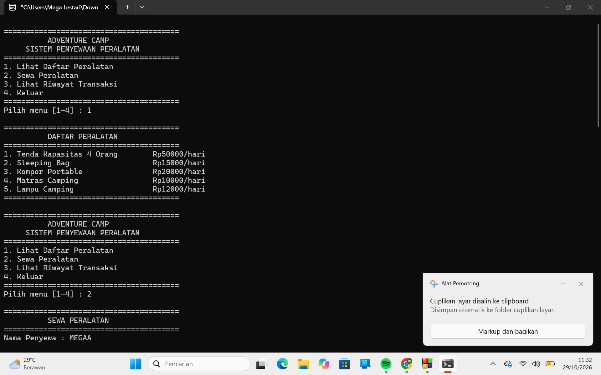
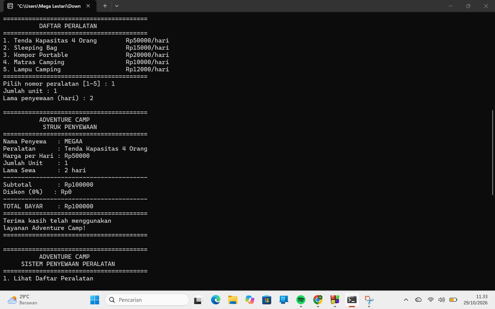
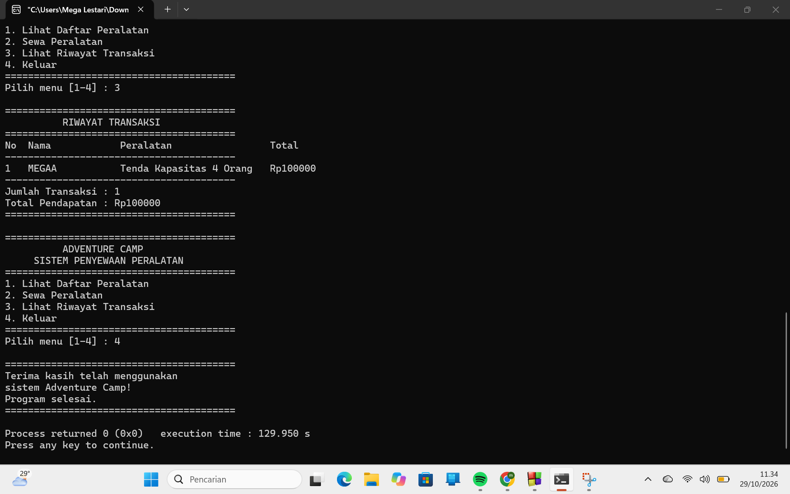

# Adventure Camp mega lestari

## Aplikasi Penyewaan Peralatan Camping Berbasis Bahasa C

### pembuat program

- *Nama:* Mega Lestari
- *NIM:* C2583207042
- *Nama Proyek:* Adventure Camp

## Deskripsi Proyek

Adventure Camp merupakan aplikasi berbasis console yang dibuat menggunakan bahasa pemrograman C untuk membantu proses pengelolaan penyewaan peralatan camping. Aplikasi ini menyediakan berbagai fitur untuk melihat daftar peralatan, melakukan penyewaan, menghitung biaya berdasarkan jumlah barang dan lama penyewaan, serta memberikan diskon sesuai dengan ketentuan yang berlaku.

Selain itu, aplikasi ini dapat menampilkan struk hasil transaksi dan menyimpan riwayat penyewaan selama program berjalan. Dengan adanya aplikasi ini, proses pencatatan transaksi dan perhitungan biaya penyewaan dapat dilakukan dengan lebih mudah, teratur, dan otomatis.

## Fitur Program

- Menampilkan daftar peralatan camping beserta harga sewanya.
- Memproses penyewaan peralatan camping.
- Menerima input nama penyewa, jenis peralatan, jumlah unit, dan lama penyewaan.
- Menghitung biaya penyewaan secara otomatis.
- Memberikan diskon berdasarkan lama penyewaan.
- Menampilkan struk transaksi yang berisi rincian penyewaan dan total pembayaran.
- Menyimpan riwayat transaksi selama program berjalan.
- Menampilkan seluruh riwayat transaksi yang telah dilakukan.
- Menghitung jumlah transaksi yang telah dilakukan.
- Menghitung dan menampilkan total pendapatan penyewaan.
- Melakukan validasi terhadap input pengguna.
- Menyediakan menu utama yang dapat digunakan berulang kali sampai pengguna memilih untuk keluar.

## Teknologi yang Digunakan

- Bahasa Pemrograman: C
- Jenis Aplikasi: Console Application
- Compiler: CodeBlocks

## Tampilan Program

### 1. Tampilan Awal Program

### 2. Tampilan Proses Penyewaan

### 3. Tampilan Hasil Transaksi

## Tujuan Proyek

Tujuan dari proyek ini adalah untuk membuat aplikasi penyewaan peralatan camping berbasis console menggunakan bahasa pemrograman C. Aplikasi ini dibuat untuk mempermudah proses pencatatan transaksi, menghitung biaya penyewaan dan diskon secara otomatis, serta menyimpan dan menampilkan riwayat transaksi. Selain itu, proyek ini bertujuan untuk menerapkan konsep dasar pemrograman seperti percabangan, perulangan, fungsi, array, dan validasi input dalam sebuah program yang terstruktur dan mudah digunakan.

---
